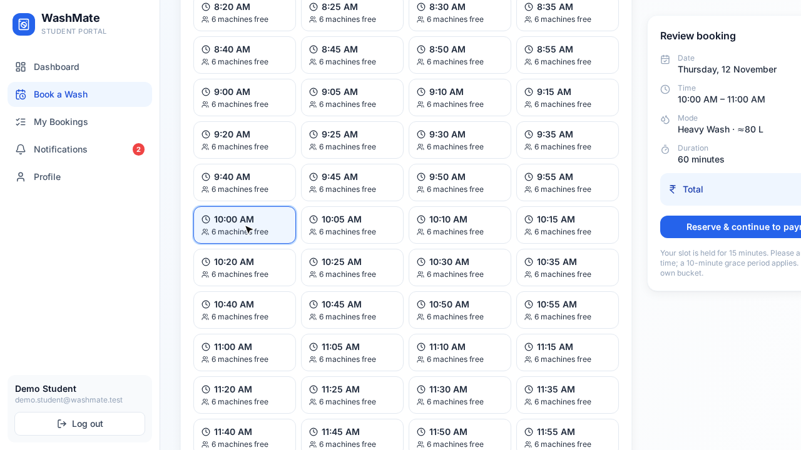
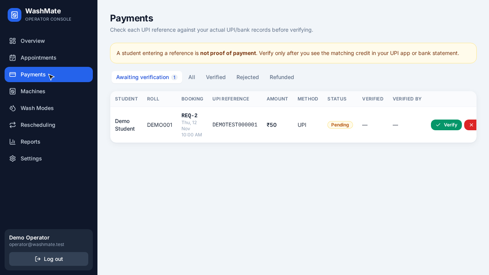
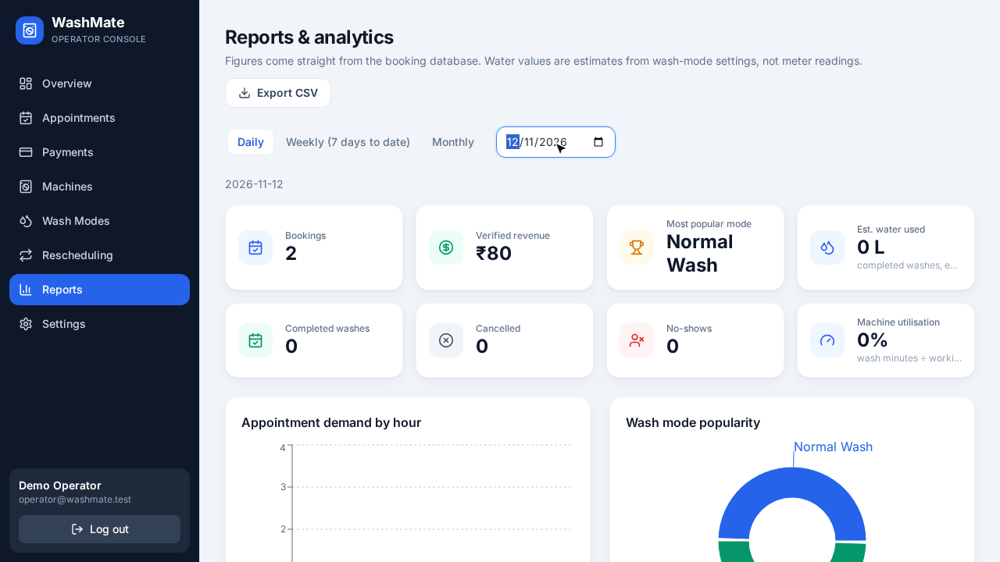

# WashMate — Smart Hostel Laundry Management System

**Book. Pay. Get reminded. Arrive. Wash.**

WashMate replaces the handwritten notebook of a hostel washing-machine operator with a shared digital system:
students book a **fixed appointment**, pay in advance by UPI, get a reminder 15 minutes before, and arrive to wash;
the operator verifies payments, manages machines/modes/appointments and sees reports.

> **Honest status:** the software is complete and tested. The **fieldwork parts of the assignment** (`research.md`,
> `fieldwork.md`, real `data/data.csv`, `reflection.md`, `ai-chats/`) are **templates waiting for you** – see
> [Fieldwork to be completed](#18-actual-fieldwork-information-to-be-completed-by-the-user).

## Contents
1. [Overview](#1-project-overview) · 2. [Problem](#2-problem-statement) · 3. [Features](#3-features) · 4. [Architecture](#4-architecture) ·
5. [Stack](#5-technology-stack) · 6. [Database](#6-database-design) · 7. [Screenshots](#7-screenshots) · 8. [Install](#8-installation) ·
9. [Backend](#9-run-the-backend) · 10. [Frontend](#10-run-the-frontend) · 11. [Operator account](#11-operator-account-creation) ·
12. [Student registration](#12-student-registration) · 13. [Payment workflow](#13-payment-verification-workflow) ·
14. [Appointment workflow](#14-appointment-workflow) · 15. [CSV analysis](#15-csv-data-analysis) · 16. [Tests](#16-automated-tests) ·
17. [Limitations](#17-limitations) · 18. [Fieldwork](#18-actual-fieldwork-information-to-be-completed-by-the-user) ·
19. [Vercel](#19-vercel-deployment) · 20. [Live URL](#20-live-application-url) · 21. [Demo video](#21-playwright-demonstration-video) ·
22. [Regenerate demo](#22-how-to-regenerate-the-demo-video)

## 1. Project overview
Two role-based portals (Student, Operator) share one Flask API and one database.
WashMate uses a **fixed appointment system** – there is deliberately **no token queue**.

## 2. Problem statement
In the hostel, the washing-machine operator keeps handwritten records of bookings and payments. Students cannot see free times,
machine breakdowns are not reflected in bookings, wash modes differ in duration/water/price, payment records are unreliable,
and the operator spends time on bookkeeping. *(This is the brief given with the assignment; confirm/correct it with your own fieldwork.)*

## 3. Features
**Student:** register/login/profile · dashboard · book a wash (mode, date, live capacity-aware slots, price/duration/water) ·
temporary slot reservation · UPI payment page (UPI ID, optional QR, transaction-reference submission) · booking confirmation with
reference (e.g. `WM-2026-001`) · my bookings (details, progress, reschedule request, cancel per policy) · notifications incl. 15-minute reminder.

**Operator:** secure separate login · live overview · machine management (add/edit/maintenance/disable/restore, at-risk booking alerts,
*never* silent cancellation) · wash-mode management (old bookings keep their price/duration/water snapshot) · appointments
(table, daily schedule, calendar; arrive → assign → start → complete, no-show after grace period, cancel with reason) ·
payment verification/rejection/refund marking · rescheduling review with availability check · reports + CSV export · settings
(hours, buffer, grace period, hold time, UPI details).

## 4. Architecture
```
 Browser (React + Vite SPA)
        │  same-origin /api  (HttpOnly JWT cookie)
        ▼
 Vercel static hosting ── /api/* ──► api/index.py (Flask WSGI serverless function)
                                          │  SQLAlchemy
                                          ▼
                       PostgreSQL (production, DATABASE_URL)   |   SQLite (local/tests)
 Vercel Cron / external cron ──► GET /api/cron/reminders  (Bearer CRON_SECRET, idempotent)
```
* `backend/app/services/scheduling.py` – capacity engine (interval overlap sweep, turnaround buffer, locking, reservation expiry).
* `backend/app/services/bookings.py` – lifecycle: create → pay → verify → arrive → assign → start → complete / cancel / no-show / reschedule.
* Locking: PostgreSQL `pg_advisory_xact_lock` (SQLite: process lock) around every capacity-changing transaction, so two students cannot take the last machine.
* Reminders: APScheduler thread locally; on Vercel an idempotent cron endpoint **plus** lazy processing whenever notifications are fetched.

## 5. Technology stack
React 18 · Vite · Tailwind CSS 3 · React Router · Axios · Lucide · Recharts · Flask · Flask-SQLAlchemy · Flask-JWT-Extended ·
Flask-CORS · Werkzeug password hashing · APScheduler · SQLite (dev/test) / PostgreSQL (prod) · Pytest · Pandas · Playwright · Vercel.

## 6. Database design
Ten tables: `users`, `machines`, `wash_modes`, `bookings`, `payments`, `machine_assignments`, `reschedule_requests`,
`notifications`, `system_settings`, `audit_logs` (`backend/app/models/__init__.py`).
Key points: unique booking reference & unique transaction reference (duplicate-payment prevention), `price/duration/water_snapshot`
on bookings, CHECK constraints on statuses/prices, indexes on `(booking_date, status)`, foreign keys everywhere, soft deletion of wash modes
that already have bookings, audit log for every state change. Small additions beyond the brief: `bookings.expires_at`, cancel reason columns,
`reschedule_requests.original_*` (history), `machines.maintenance_*`.

Booking statuses: `RESERVED → PAYMENT_SUBMITTED → CONFIRMED → ARRIVED → WASHING → COMPLETED` (plus `CANCELLED`, `NO_SHOW`, `REJECTED`, `EXPIRED`).
Payment statuses: `PENDING`, `VERIFIED`, `REJECTED`, `REFUNDED`.

## 7. Screenshots
Captured automatically from the running app by the Playwright demo – see [`demo/screenshots/`](demo/screenshots/).

| Student booking | Operator payments | Operator reports |
|---|---|---|
|  |  |  |

## 8. Installation
Requirements: Python 3.10+, Node 18+, Git.
```bash
git clone https://github.com/Kolpi03/washmate.git && cd washmate
python3 -m venv .venv && source .venv/bin/activate
pip install -r backend/requirements.txt
npm --prefix frontend install
cp .env.example .env        # optional for local runs
```

## 9. Run the backend
```bash
source .venv/bin/activate
python backend/run.py                 # http://127.0.0.1:5000 ; creates tables + default modes/machines on first start (SQLite)
```
Initialise a database explicitly (safe, never drops anything): `python backend/manage.py init-db`

## 10. Run the frontend
```bash
npm --prefix frontend run dev         # http://localhost:5173 (proxies /api to :5000)
npm --prefix frontend run build       # production build -> frontend/dist
```

## 11. Operator account creation
Public operator registration does not exist. Create the first operator from the terminal:
```bash
source .venv/bin/activate
python backend/manage.py create-operator --email operator@yourhostel.example    # prompts for the password
# or non-interactive: OPERATOR_PASSWORD='…' python backend/manage.py create-operator --email …
```
Then sign in at `/operator/login` and set your **UPI ID**, hours and policies under *Settings*, and your real prices under *Wash Modes*.
(Initial modes/prices/durations/water values are **illustrative only**.)

## 12. Student registration
Open `/register`, enter name, roll number, email, hostel and a password (≥ 8 chars). Passwords are stored as Werkzeug hashes.
Students can never obtain the operator role through the API.

## 13. Payment verification workflow
1. Student reserves a slot → capacity is held for `reservation_hold_minutes` (default 15).
2. Student pays the operator's UPI ID in their own UPI app and submits the **transaction reference**.
3. Booking becomes `PAYMENT_SUBMITTED`; the payment is still **PENDING** – nothing is marked paid automatically.
4. The operator compares the reference with the real UPI/bank records and clicks **Verify** (→ `CONFIRMED`, reference `WM-YYYY-NNN`, student notified)
   or **Reject** (slot released). Duplicate references are refused. There is **no payment-gateway integration**.

## 14. Appointment workflow
Book → pay → operator verifies → reminder 15 min before → student arrives (10-minute grace, configurable) → operator marks *arrived* →
assigns a machine (overlap-checked) → *start* → *complete*. After the grace period the operator may mark `NO_SHOW` (no automatic penalty).
Reschedule: student request → operator availability check → approve/reject (capacity re-validated at approval; original time kept in history).
Machine breakdown: capacity drops immediately, affected bookings are listed (never auto-cancelled) and the operator can ask students to reschedule.

## 15. CSV data analysis
`data/data.csv` is a **header-only template** for your own real observations (see [`data/README.md`](data/README.md)).
```bash
source .venv/bin/activate
python analysis/daily_report.py                       # prints validation issues + report
python analysis/daily_report.py --machines M1,M2,M3 --json report.json
```
Validates missing fields, invalid durations/prices/dates/timestamps, duplicates, wrong machine identifiers; warns when fewer than 20 valid records;
reports totals, completed sessions, popular mode, average duration, revenue, **measured vs estimated** water (kept separate), utilisation and peak hours.

## 16. Automated tests
```bash
source .venv/bin/activate
python -m pytest tests/backend -q            # 41 backend tests (separate temporary SQLite DB per test)
node --test tests/frontend/format.test.mjs   # 3 frontend utility tests
```
Backend tests cover registration/login/roles, unauthorized access, wash modes & machines, capacity & overlap, **8-thread concurrent booking of the last machine**,
reservation expiry, UPI submission/verification/duplicates, reminders (+no duplicates), grace period/no-show, rescheduling (approve/reject/revalidation), completion, reports, CSV validation.

## 17. Limitations
* No real payment gateway – payments are verified manually by the operator (by design).
* Reminders are **in-app** (+ optional browser notifications). No SMS/WhatsApp/email is sent.
* Vercel Hobby cron runs once a day; between cron runs reminders are generated lazily when any user's app polls notifications (every 30 s while open),
  or call `/api/cron/reminders` every minute from an external cron service (e.g. cron-job.org) with `Authorization: Bearer $CRON_SECRET`.
* Occupancy uses configured mode durations; actual wash times may differ. Water figures are estimates.
* One shared turnaround buffer; times are hostel-local (`APP_TIMEZONE`, default Asia/Kolkata); no rate limiting; no email verification/password reset.
* The initial prices/durations/water values are illustrative.

## 18. Actual fieldwork information to be completed by the user
**Pending – nothing here has been fabricated.** You must personally: visit the hostel laundry, interview the operator, take two timestamped photos,
record ≥ 20 real observations in `data/data.csv`, fill `research.md` and `fieldwork.md`, write `reflection.md` **without AI**, and add real exported chats to `ai-chats/`.

## 19. Vercel deployment
Account `kalpitasaha03-6566`, project `washmate`. `vercel.json` builds the SPA to `frontend/dist`, routes `/api/*` to `api/index.py` and everything else to `index.html`.

Environment variables (Vercel → Project → Settings → Environment Variables, or `vercel env add`):

| Variable | Purpose |
|---|---|
| `DATABASE_URL` | hosted PostgreSQL connection string (e.g. Neon). **Required** on Vercel |
| `SECRET_KEY`, `JWT_SECRET_KEY` | long random strings |
| `FLASK_ENV` | `production` |
| `FRONTEND_URL` | the deployed URL (CORS) |
| `VITE_API_URL` | leave empty (same-origin `/api`) |
| `UPI_ID`, `UPI_QR_CODE_URL` | defaults shown to students (editable later in Settings) |
| `CRON_SECRET` | protects `/api/cron/reminders` (Vercel Cron sends it automatically) |

One-time schema setup (never run per request; never drops data):
```bash
DATABASE_URL='postgresql://…' python backend/manage.py init-db
DATABASE_URL='postgresql://…' OPERATOR_PASSWORD='…' python backend/manage.py create-operator --email you@example.com
vercel --prod
```

## 20. Live application URL
See the **Deployment status** block at the bottom of this README (updated after the production deployment was verified).

## 21. Playwright demonstration video
`demo/washmate-demo.mp4` – silent screen recording (no audio track) of the real app with visible cursor: student login → dashboard → book a wash
(mode, price/duration/water, slot, review) → UPI payment instructions + test reference → booking details → 15-minute reminder → operator login →
overview → machine maintenance & restore → wash-mode configuration → payment verification → appointments (table/schedule/calendar) →
rescheduling approval → reports & CSV export. Environment: **local instance** with a throw-away SQLite database, dedicated **test accounts**,
a fake UPI ID and a fake transaction reference. Details: [`demo/README.md`](demo/README.md).

## 22. How to regenerate the demo video
```bash
npm install                                  # installs Playwright
npx playwright install chromium
source .venv/bin/activate
bash demo/serve-demo.sh                      # terminal 1: fresh isolated app on :4173 (re-run to reset)
node tests/e2e/demo.spec.js                  # terminal 2: records ~3 min (also waits ~1–7 min for the real reminder)
ffprobe -v error -show_entries stream=codec_type -of csv=p=0 demo/washmate-demo.mp4   # prints only: video
```
Requires `ffmpeg`/`ffprobe`. Run before 23:30 local server time.
